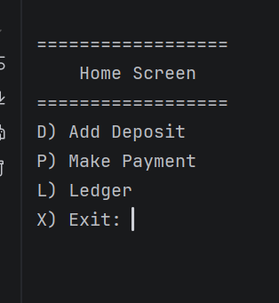

# Accounting Ledger

Accounting ledger can track all financial transactions for a
business or for personal use. It adds deposits or payments made and
if the user wants reports it will be displayed to them upon request.

## Features

- Add Deposit
- Make Payment (Debit)
- Option to display all entries 
- Display deposits made into the account
- Display payments made into the account
- Show report of Month To Date
- Show report of Previous Month
- Show report of Year To Date
- Show report of  Previous Year
- Search by Vendor

## How to run it

1. Clone the repository and open it in IntelliJ
2. Run `[App].java`
3. Type an option from the Home Screen. Ex: `D`

## Screenshots




## Interesting code

[One piece of code you're proud of, and a sentence about why.]

```java
[your code here]
```

## Author

Ruby Santos, Year Up Java Academy